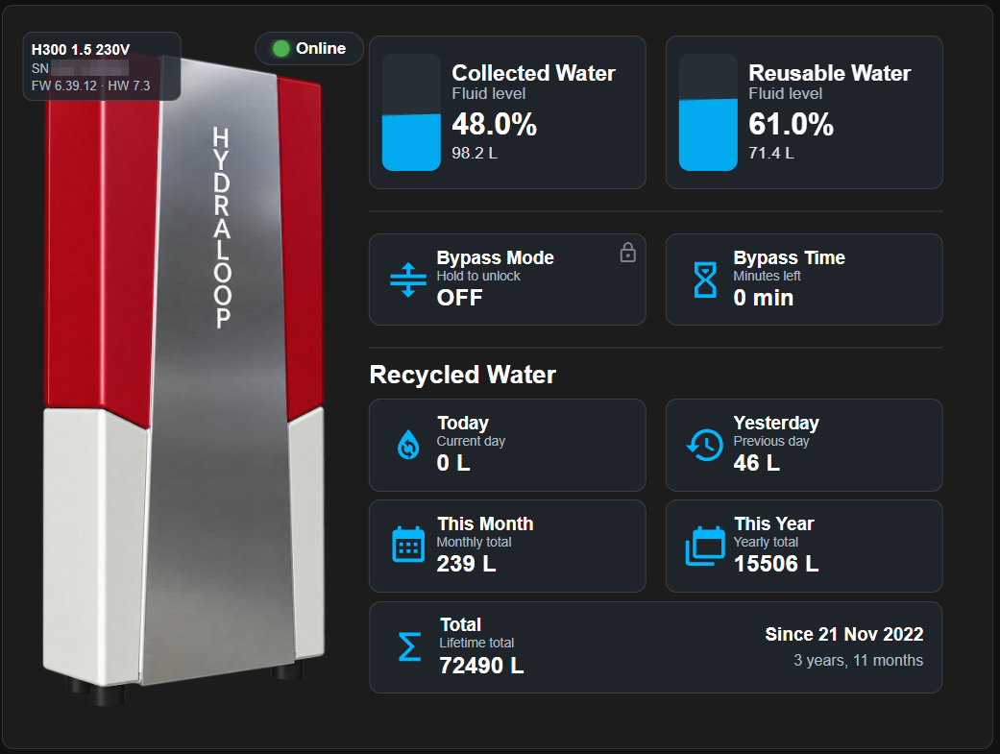
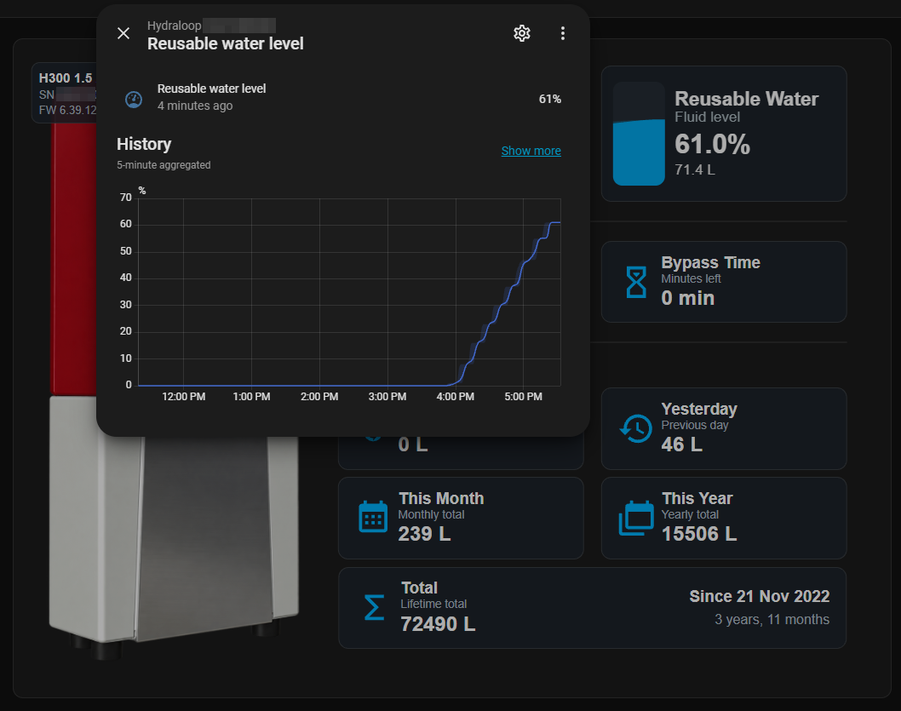
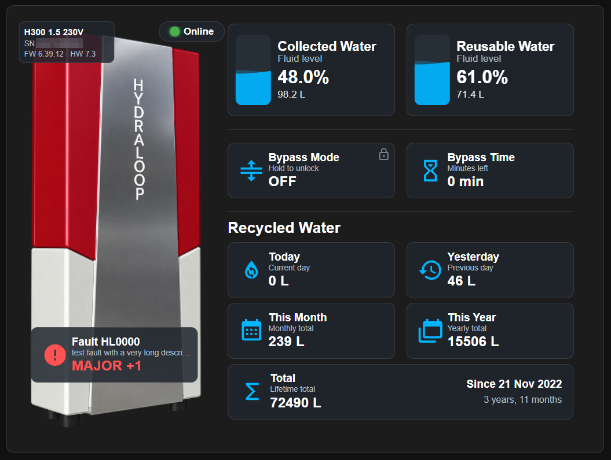
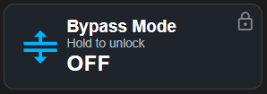
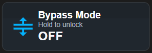

# Hydraloop for Home Assistant

A small bridge that reads your [Hydraloop](https://www.hydraloop.com) water recycling system from the Hydraloop Device Manager (HDM) External API and publishes it to Home Assistant over MQTT, using MQTT discovery. A ready-made dashboard card is included.

This is a community project. It is not affiliated with or endorsed by Hydraloop.

## Screenshots

Normal operation:



Tap a tank or a statistic to open the history of that value:



Faults appear in a dedicated card, only while HDM reports a problem:



To prevent accidental activation, the bypass button is locked. Hold it until the lock icon disappears, then tap within 5 seconds to switch the bypass. After that the lock comes back.

<p>
  
  
</p>

## What you get

One Home Assistant device per Hydraloop coupled to your API key, with:

| Entity | Description |
|---|---|
| Collected water level / volume | Tank 2 (collected grey water), % and L |
| Reusable water level / volume | Tank 3 (treated water ready for reuse), % and L |
| Water recycled today, yesterday, this month, this year, total | In litres. The total covers the whole life of the appliance |
| Bypass | Switch that turns bypass mode on and off (see [Bypass control](#bypass-control)) |
| Bypass minutes remaining | Time left in bypass mode |
| Online | Connectivity as reported by HDM. Unknown when the API does not answer |
| Problem | On when HDM reports a minor, major or blocking issue. The `issues` attribute lists them |
| State, Firmware, Serial, Commissioned | Diagnostic values |

The tank volume sensors carry the time of the last reading in the `last_reading` attribute. The device page also shows the model and hardware version.

## Requirements

- An API key for the HDM External API. Ask Hydraloop support for one: see [How to use the Hydraloop API](https://info.hydraloop.com/manuals/how-to-use-the-hydraloop-api).
- Home Assistant with the MQTT integration and discovery enabled (the default).
- An MQTT broker, for example the Mosquitto add-on.
- Docker with Docker Compose on any machine that can reach the broker and the internet.

## Install the bridge

```sh
git clone https://github.com/axelfurlan/hydraloop-home-assistant.git
cd hydraloop-home-assistant
cp .env.example .env
# edit .env: at least HYDRALOOP_API_KEY and MQTT_HOST
docker compose up -d --build
docker compose logs -f
```

A healthy start logs `Found 1 device(s)` and `Connected to MQTT broker`. The entities then appear in Home Assistant under **Settings → Devices & services → MQTT**.

All settings are described in [.env.example](.env.example).

## Bypass control

The bypass switch sends real commands to the appliance through HDM. After a command the bridge waits until HDM reports the new state, which can take up to a minute. If you only want to see the bypass state, set `HYDRALOOP_ALLOW_BYPASS_CONTROL=false`: the bypass then becomes a read-only sensor.

## Dashboard card

The card in [dashboard/hydraloop-card.yaml](dashboard/hydraloop-card.yaml) shows both tanks with an animated level, the bypass control, the recycled water statistics, an online badge, device details and a fault card that appears only when there is a problem.

1. Install these frontend cards from [HACS](https://hacs.xyz):
   - [button-card](https://github.com/custom-cards/button-card) (tested with 7.0.1)
   - [fluid-level-background-card](https://github.com/swingerman/lovelace-fluid-level-background-card) (tested with 0.2.0)
2. Replace every `yourserial` in the file with your Hydraloop serial in lower case, for example `ha12345678`. Your entity ids show the exact value: `sensor.hydraloop_<serial>_water_recycled_today`.
3. Copy [dashboard/hydraloop.png](dashboard/hydraloop.png) to `config/www/hydraloop.png` in Home Assistant. You can use any transparent PNG of the appliance instead.
4. In a dashboard, add a **Manual** card and paste the file content. The card is built for a sections view at full width (24 columns). Text scales with the card size.

The bypass button is locked against accidental taps: hold it to unlock, then tap within 5 seconds.

## Notes and limits

- Data comes from the HDM cloud every 10 minutes by default (`POLL_INTERVAL`). There is no local connection to the appliance.
- 0% does not mean empty: the tank windows start above the bottom, so a tank at 0% still holds a few litres.
- HDM reports overdue maintenance as `attentionRequired`. The bridge shows it in the State sensor but does not count it as a problem.
- Backup water (mains top-up) is not available: Hydraloop removed those API endpoints because the estimate was not accurate enough.
- The tank level sensors get the fixed entity ids `sensor.hydraloop_collected_water` and `sensor.hydraloop_reusable_water`. With more than one Hydraloop, Home Assistant adds a suffix to the second device.

## License

The code and the card are released under the [MIT](LICENSE) license.
